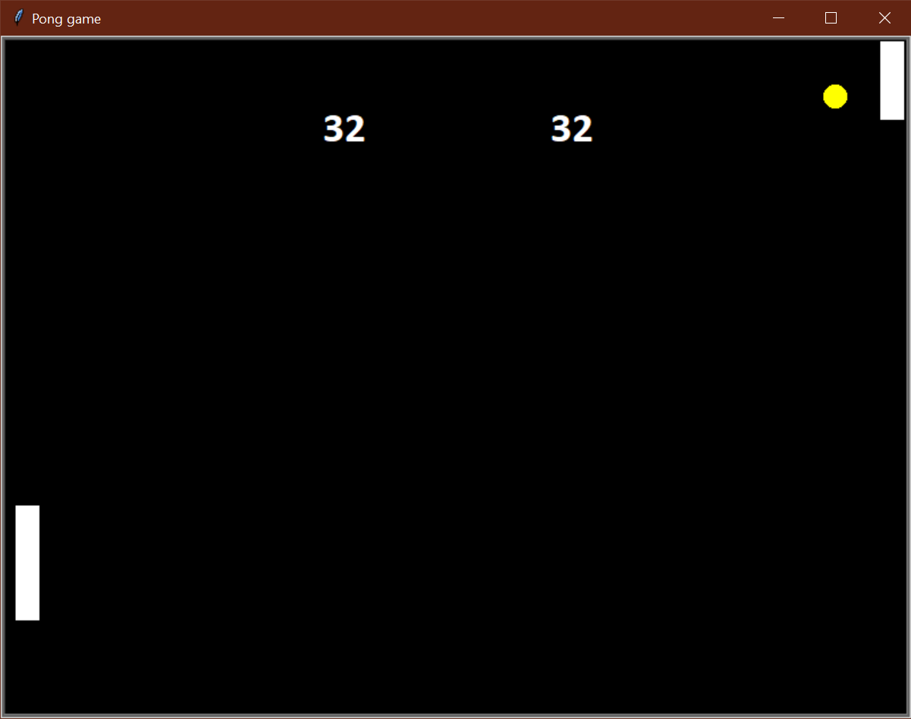

# 🐍 Python Udemy Learning Journey

Welcome to my Python learning repository!

This repository documents my journey of learning Python through structured courses, hands-on coding exercises, challenges and practical projects.

## 📚 Learning Resources

**Primary Course:** [100 Days of Code: The Complete Python Pro Bootcamp](https://www.udemy.com/course/100-days-of-code/)

**Instructor:** Dr. Angela Yu (Udemy)

## 📂 Repository Contents

| Folder | Description |
|---|---|
| `turtle-graphics/` | Python Turtle challenges, creative drawings and projects, including Hirst-inspired dot painting, Turtle Race, Snake Game and Pong Game. |
| `turtle-graphics/snake_game/` | A classic Snake Game featuring OOP, collision detection, pause/resume, restart functionality and persistent high scores. |
| `turtle-graphics/pong_game/` | A two-player Pong game featuring paddle controls, ball physics, collision detection and continuous score tracking. |

### 🐍 Featured Project: Snake Game

A classic Snake Game built using Python's Turtle Graphics module.

**Features:**
- Arrow-key movement and snake growth.
- Turtle-shaped food.
- Wall and self-collision detection.
- Pause and resume functionality.
- Restart or exit after Game Over.
- Persistent high score using file handling.

[Explore the Snake Game →](turtle-graphics/snake_game/)

### 🏓 Featured Project: Pong Game

A two-player Pong game built using Python's Turtle Graphics module and Object-Oriented Programming.

**Features:**
- Independent keyboard controls for both players.
- Ball movement and bouncing off the top and bottom walls.
- Paddle collision detection.
- Score tracking for both players.
- Increasing ball speed after paddle hits.
- Continuous gameplay with no fixed winning score or Game Over condition.

[Explore the Pong Game →](turtle-graphics/pong_game/)

More exercises and projects will be added as I progress through the course.

## 🛠️ Technologies & Tools

- Python 3
- VS Code
- Git & GitHub
- Python libraries and modules

## 🎯 Learning Goals

- Strengthen Python programming fundamentals.
- Develop problem-solving and logical thinking.
- Practise writing clean, reusable code.
- Build practical projects.
- Maintain consistency through hands-on learning.

---

*Learning by doing, one project at a time.* 🚀
