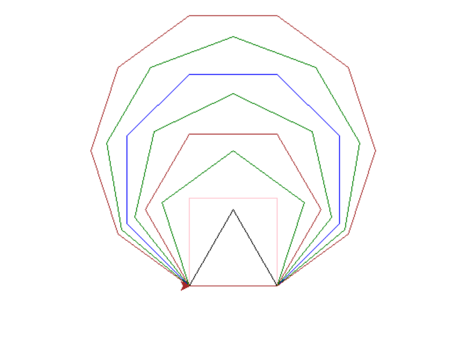
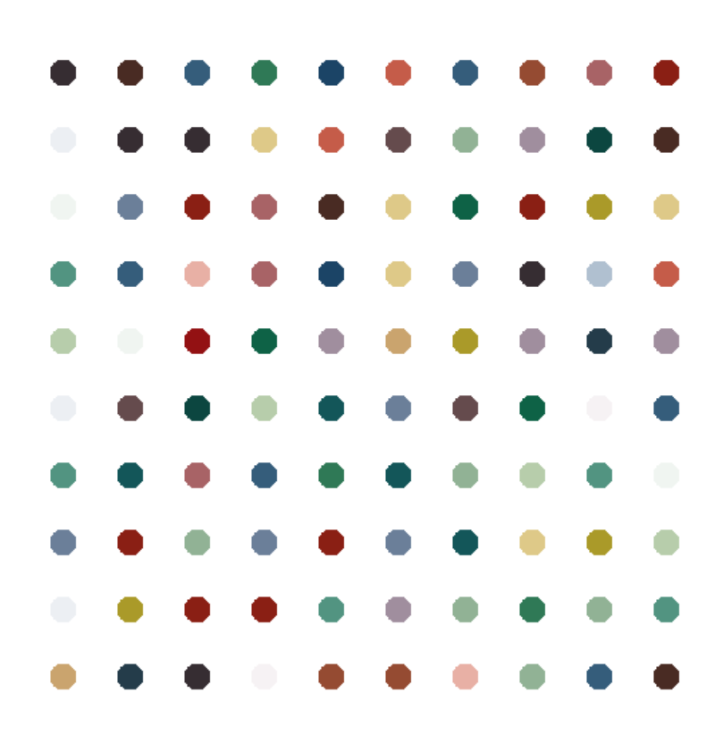
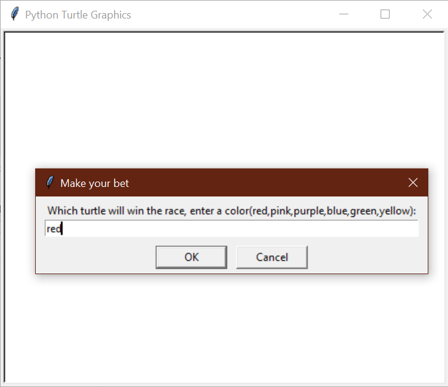

# 🎨 Turtle Graphics – Python Projects

A collection of Python Turtle Graphics exercises and creative projects completed while learning **100 Days of Code: The Complete Python Pro Bootcamp** by Angela Yu on Udemy.

## 📌 Concepts Covered

- Turtle Graphics and coordinate systems
- Loops, functions and iterations
- Lists, tuples and randomisation
- RGB colour generation and colour extraction
- Geometric shapes, random walks and spirographs
- Object instances and object-oriented programming
- Event listeners and keyboard controls
- User input and conditional logic

## 🐢 Challenges & Projects

| Python File | Description |
|---|---|
| `turtle_challenges.py` | Geometric shapes, polygons, random walks and spirographs |
| `hirst_painting.py` | Hirst-inspired dot painting using RGB colours |
| `turtle_race.py` | Interactive racing game with six coloured turtles and random movement |
| `etch_a_sketch.py` | Keyboard-controlled drawing application using W, A, S, D and C |

## 🖼️ Visual Outputs

### 1. Geometric Shapes


### 2. Dashed Square


### 3. Geometric Polygons


### 4. Spirograph


### 5. Random Walk


### 6. Hirst-Inspired Dot Painting


### 7. Turtle Race



### 8. Etch-A-Sketch


## ⚙️ Installation & Execution

**Prerequisite:** Python 3.

Install dependencies:

```bash
pip install -r requirements.txt
```

Run any project:

```bash
python turtle_challenges.py
python hirst_painting.py
python turtle_race.py
python etch_a_sketch.py
```

## 📦 Libraries Used

- `turtle` – Graphics and interactive drawing.
- `random` – Random choices and movement.
- `colorgram.py` – RGB colour extraction.

*Turtle and random are part of Python's standard library.*

---

*Learning by doing, one project at a time.* 🚀
