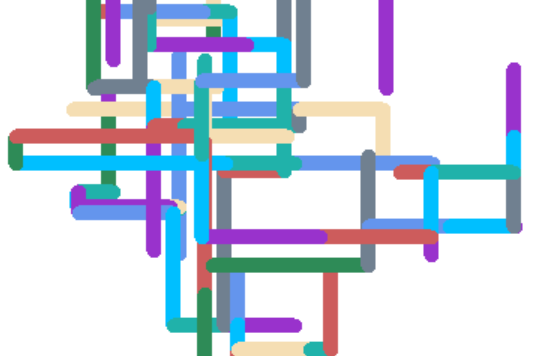

# 🎨 Turtle Graphics – Python Projects

A collection of Python Turtle Graphics exercises and creative coding challenges completed while learning Python through Angela Yu's **100 Days of Code: The Complete Python Pro Bootcamp** on Udemy.

## 📌 Concepts Covered

- Turtle Graphics
- Loops and iterations
- Functions and code reusability
- Random module
- Lists and tuples
- RGB colour generation
- Random walks
- Geometric shapes
- Spirograph patterns
- Colour extraction using `colorgram`

## 🐢 Challenges & Projects

| Python File | Description |
|---|---|
| `turtle_challenges.py` | Geometric shapes, dashed lines, polygons, random walks and spirographs |
| `hirst_painting.py` | Hirst-inspired dot painting using randomly selected RGB colours |

## 🖼️ Visual Outputs

### 1. Geometric Shapes


### 2. Dashed Square


### 3. Geometric Polygons


### 4. Spirograph


### 5. Random Walk


### 6. Hirst-Inspired Dot Painting


## ⚙️ Installation & Execution

**Prerequisites:** Python 3 installed on your system.

Install the required dependency:

```bash
pip install -r requirements.txt
```

Run the exercises:

```bash
python turtle_challenges.py
```

Run the dot painting:

```bash
python hirst_painting.py
```

## 📦 Libraries Used

- `turtle` – Drawing and graphics.
- `random` – Random choices, directions and RGB values.
- `colorgram.py` – Extracting RGB colours from images.

**Note:** Turtle is included in Python's standard library.

## 💡 Key Takeaway

Exploring how fundamental Python concepts can be combined to create interactive drawings, geometric patterns and colourful digital artwork.
