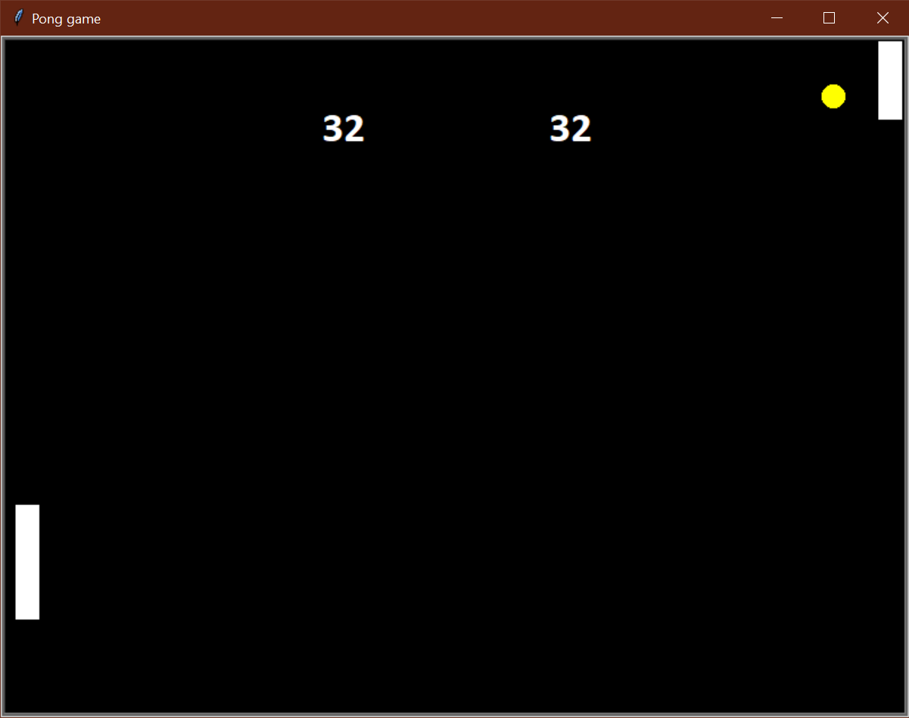

# 🏓 Pong Game

A two-player Pong game built with Python's Turtle Graphics module as part of my **100 Days of Code: The Complete Python Pro Bootcamp (Udemy)** learning journey.

The project uses Object-Oriented Programming (OOP) to organise the paddles, ball and scoreboard into separate classes.

## 🖼️ Game Preview



## 🎮 Features

- Two-player gameplay on one keyboard.
- Ball movement with horizontal and vertical wall bouncing.
- Paddle collision detection.
- Score tracking for both players.
- Ball speed increases after successful paddle hits.
- Ball resets and changes direction after a missed shot.
- Paddle movement is restricted to the game window.
- Continuous, score-based gameplay with no fixed winning score or Game Over condition.
- Press Escape to stop the game.

## 📂 Project Structure

| File | Description |
|---|---|
| `main.py` | Screen setup, keyboard controls, game loop and collision detection |
| `paddle.py` | Paddle class and movement controls |
| `ball.py` | Ball movement, bouncing, speed and reset logic |
| `scoreboard.py` | Score tracking and display |

## 🕹️ Controls

| Player | Move Up | Move Down |
|---|---|---|
| Right paddle | ↑ Up Arrow | ↓ Down Arrow |
| Left paddle | W | S |

Press **Escape** to stop the game. Click the window to close it after stopping.

## 🛠️ Concepts Practised

- Object-Oriented Programming
- Classes, objects and inheritance
- Turtle Graphics
- Keyboard event handling
- Game loops and animation
- Collision detection
- Conditional logic
- Methods and attributes

## 🚀 How to Run

**Prerequisite:** Python 3.

No external Python packages are required. The project uses Python's built-in `turtle` and `time` modules.

Run from this directory:

```bash
python main.py
```

---

*Built while learning Python and practising Object-Oriented Programming.* 🏓
