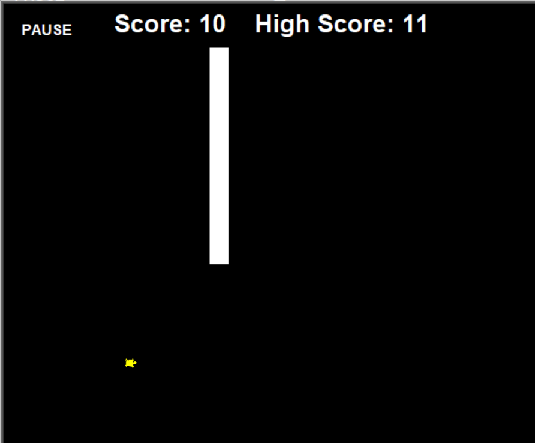
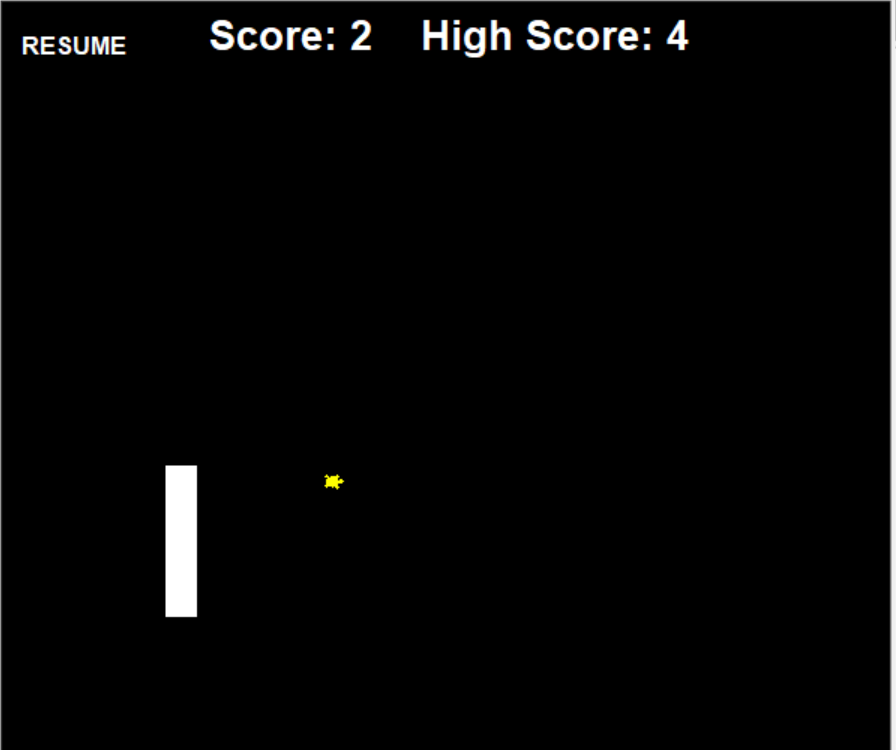
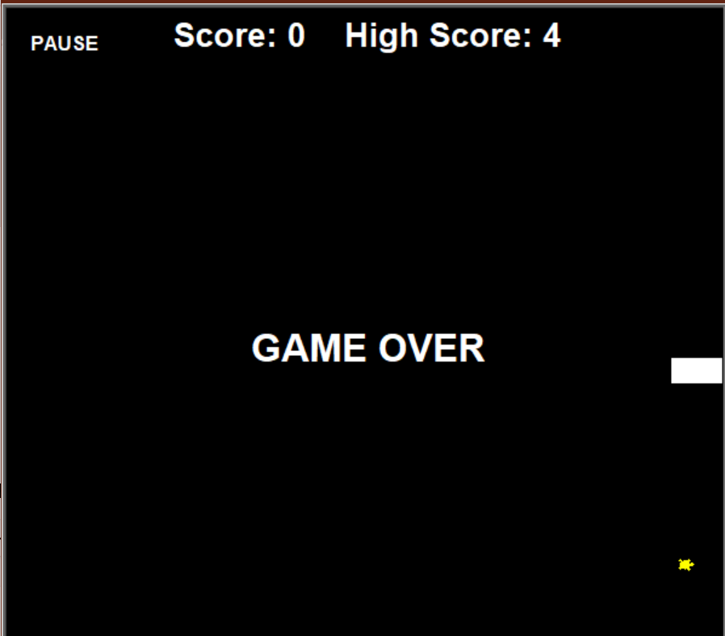
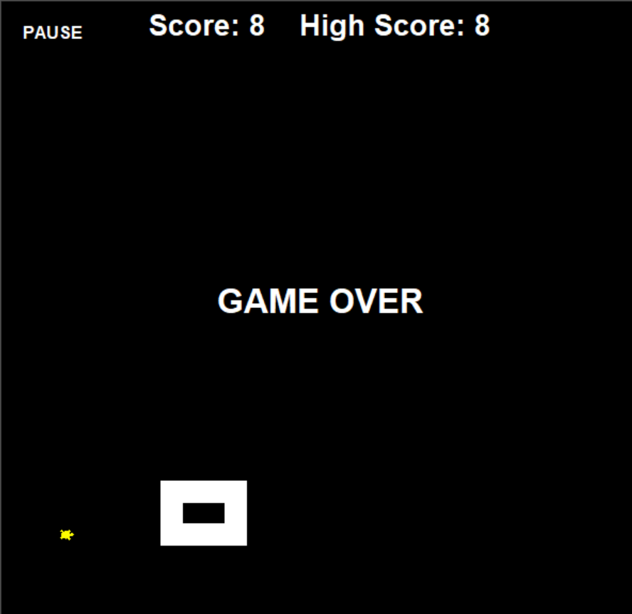
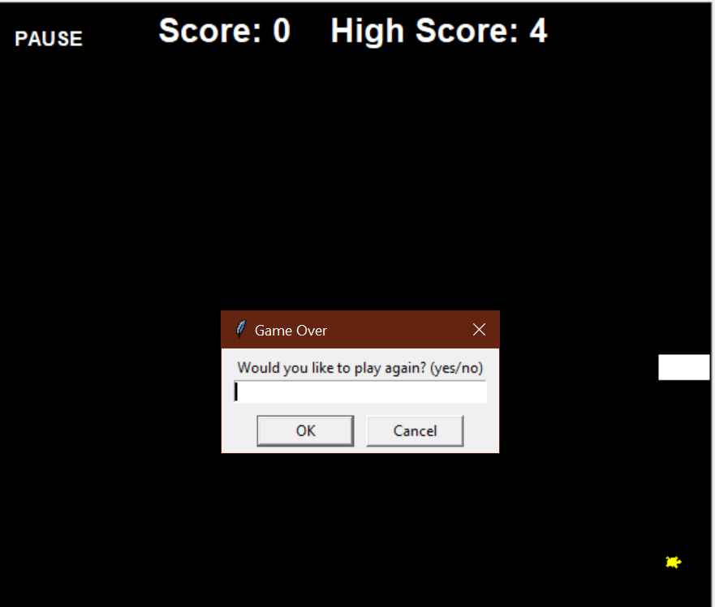

# 🐍 Snake Game

A classic Snake Game built using Python's Turtle Graphics module as part of my **100 Days of Code: The Complete Python Pro Bootcamp (Udemy)** learning journey.

The project uses Object-Oriented Programming (OOP) to organise game components into separate classes and modules.

## 🎮 Preview



## ✨ Features

- **Snake Movement:** Control the snake using the four arrow keys.
- **Turtle-Shaped Food:** Collect turtle-shaped food to increase your score.
- **Snake Growth:** The snake grows after eating food.
- **Collision Detection:** Game ends when the snake hits a wall or its own tail.
- **Score Tracking:** Displays the current score and highest score.
- **Persistent High Score:** Saves the highest score in a local text file and retains it across game sessions.
- **Pause & Resume:** Pause or resume the game by clicking the on-screen text.
- **Restart Option:** Choose whether to restart or exit after Game Over.

## 📸 Screenshots

### 1. Pause & Resume

Click the on-screen PAUSE text to stop the game and RESUME to continue.



### 2. Wall Collision

The game ends when the snake hits the game boundaries.



### 3. Self Collision

The game ends when the snake collides with its own body.



### 4. Restart Game

After Game Over, click the screen to choose whether to start a new game or exit.



## 📂 Project Structure

| File | Description |
|---|---|
| `main.py` | Game setup, controls and main game loop |
| `snake.py` | Snake creation, movement, growth and reset |
| `food.py` | Food generation and positioning |
| `score.py` | Score and high score management |
| `high_score.txt` | Stores the highest score |

## 🛠️ Technologies & Concepts

- Python
- Turtle Graphics
- Object-Oriented Programming
- Classes and Objects
- Inheritance
- Event Handling
- Collision Detection
- File Handling

## 🚀 How to Run

1. Make sure Python 3 is installed.
2. Clone or download this repository.
3. Navigate to the `snake_game` directory.
4. Run the following command:

```bash
python main.py
```

No external Python packages are required.

## 🎯 Controls

| Action | Control |
|---|---|
| Move Up | ↑ Up Arrow |
| Move Down | ↓ Down Arrow |
| Move Left | ← Left Arrow |
| Move Right | → Right Arrow |
| Pause | Click PAUSE |
| Resume | Click RESUME |
| Restart | Click anywhere after Game Over |
| Exit | Select No in the restart prompt |

---

*Built while learning Python, practising Object-Oriented Programming and exploring Turtle Graphics.*
